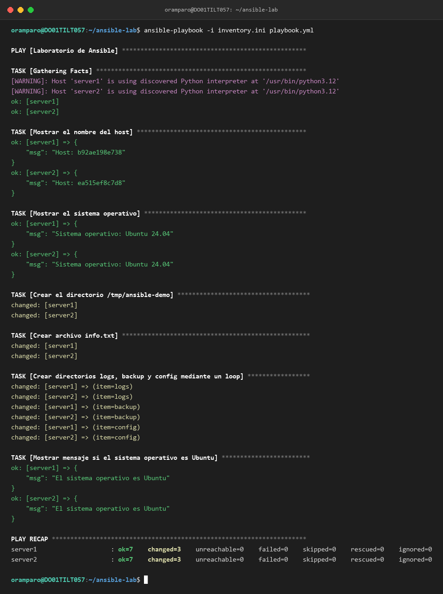

# Laboratorio de Ansible con Docker

## Objetivo de la práctica
Aprender a gestionar y configurar servidores de forma automatizada utilizando Ansible sobre contenedores Docker. A través del playbook se recopila información del host, se crean archivos y directorios mediante loops y se ejecutan tareas condicionales basadas en el sistema operativo.

## Comandos para iniciar los contenedores
Iniciar los servidores en segundo plano con Docker Compose:

```bash
docker compose up -d
```

Verificar que ambos contenedores se encuentren en ejecución:

```bash
docker ps
```

Instalar Python en cada contenedor:

```bash
docker exec -it server1 bash
apt update
apt install -y python3
exit

docker exec -it server2 bash
apt update
apt install -y python3
exit
```

Comprobar la conexión desde Ansible:

```bash
ansible docker -i inventory.ini -m ping
```

## Comando para ejecutar el playbook
Ejecutar el playbook en los servidores configurados en el inventario:

```bash
ansible-playbook -i inventory.ini playbook.yml
```

## Captura de pantalla de la ejecución exitosa

